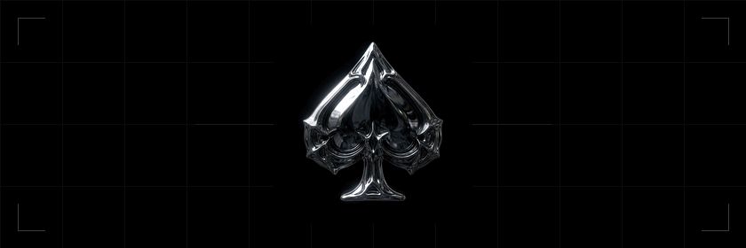
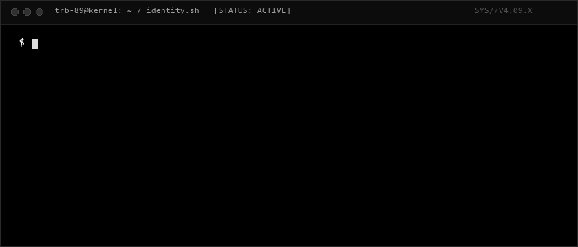
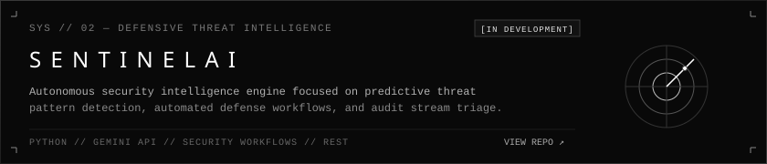
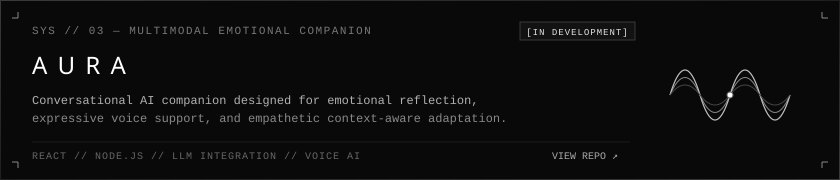
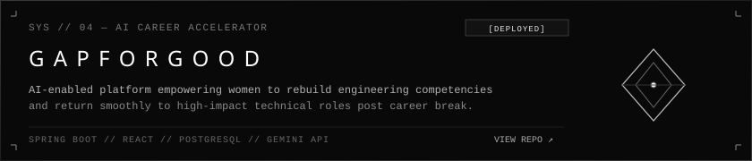
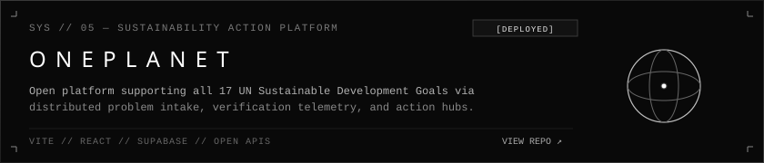
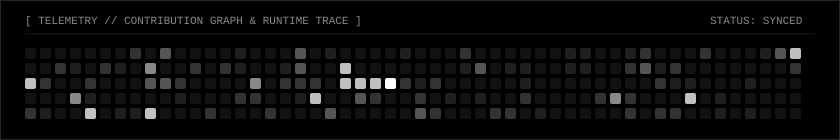
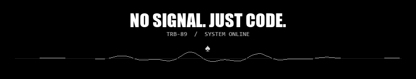

<div align="center">

<!-- ========================================== -->
<!-- 00 // HERO: ANIMATED CHROME SPADE          -->
<!-- ========================================== -->



<br/><br/>

<!-- ========================================== -->
<!-- HERO HEADING: MONOCHROME GLITCH TYPOGRAPHY -->
<!-- ========================================== -->


<p align="center">
  
</p>


<br/><br/>

<!-- ========================================== -->
<!-- 01 // ANIMATED TERMINAL RUNTIME            -->
<!-- ========================================== -->



<br/><br/>


</div>

<br/>

<!-- ========================================== -->
<!-- 01 // THE ARCHITECT                        -->
<!-- ========================================== -->

### `01 / THE ARCHITECT`

> *"Building intelligent systems that think, adapt, and act. Exploring the intersection of autonomous AI agents, software engineering, and human-centered technology."*

```
┌── [ SYSTEM DOSSIER ] ────────────────────────────────────────────────────────┐
│                                                                              │
│  DOMAIN FOCUS                                                                │
│  ├── AI Agent Engineering      · Autonomous multi-agent coordination & tool  │
│  ├── Autonomous Systems        · Self-correcting task loops & memory meshes  │
│  ├── Full-Stack Development    · High-throughput distributed architectures   │
│  ├── Machine Learning          · LLM fine-tuning, embeddings & inference     │
│  └── Applied AI Research       · Context synthesis & human-AI collaboration  │
│                                                                              │
│  STATUS: ONLINE // SECURITY CLEARANCE: LEVEL 0 // PROTOCOL: AGENTIC_EXEC     │
└──────────────────────────────────────────────────────────────────────────────┘
```

<br/>

<div align="center">
  
</div>

<br/>

<!-- ========================================== -->
<!-- 02 // SELECTED WORKS                       -->
<!-- ========================================== -->

### `02 / SELECTED WORKS`

<p>Selected engineering systems, autonomous runtimes, and distributed applications.</p>

<br/>

<!-- PROJECT 01: AGENT.OS -->
<a href="https://github.com/trb-89/agent-os">
  
</a>

<details>
<summary><b>SYSTEM SPECIFICATIONS // AGENT.OS</b></summary>

- **Classification:** Experimental Autonomous Runtime
- **Core Architecture:** Task orchestration graph, dynamic tool execution sandbox, persistent memory layers (short-term buffer + long-term vector embeddings).
- **Capabilities:** Self-directed multi-step task breakdown, autonomous agent collaboration mesh, API introspection.
- **Status:** `[ EXPERIMENTAL // CORE R&D ]`
- **Repository:** [`github.com/trb-89/agent-os`](https://github.com/trb-89/agent-os)

</details>

<br/>

<!-- PROJECT 02: SENTINEL AI -->
<a href="https://github.com/trb-89/sentinel-ai">
  
</a>

<details>
<summary><b>SYSTEM SPECIFICATIONS // SENTINEL AI</b></summary>

- **Classification:** Predictive Defense Intelligence
- **Core Architecture:** Real-time event stream analysis, automated vulnerability heuristics, LLM-guided threat mitigation.
- **Capabilities:** Automated intrusion detection triage, adversarial prompt deflection, declarative security policy enforcement.
- **Status:** `[ ACTIVE PROTOTYPE // SEC-OPS ]`
- **Repository:** [`github.com/trb-89/sentinel-ai`](https://github.com/trb-89/sentinel-ai)

</details>

<br/>

<!-- PROJECT 03: AURA -->
<a href="https://github.com/trb-89/aura">
  
</a>

<details>
<summary><b>SYSTEM SPECIFICATIONS // AURA</b></summary>

- **Classification:** Multimodal Emotional Companion
- **Core Architecture:** Low-latency conversational loop, vocal prosody synthesis, longitudinal sentiment memory tracking.
- **Capabilities:** Empathetic dialog generation, personalized emotional check-ins, adaptive reflective journaling.
- **Status:** `[ IN DEVELOPMENT // MULTIMODAL ]`
- **Repository:** [`github.com/trb-89/aura`](https://github.com/trb-89/aura)

</details>

<br/>

<!-- PROJECT 04: GFG — GAP FOR GOOD -->
<a href="https://github.com/trb-89/gap-for-good">
  
</a>

<details>
<summary><b>SYSTEM SPECIFICATIONS // GAP FOR GOOD</b></summary>

- **Classification:** AI Career Acceleration Platform
- **Core Architecture:** Skill gap diagnosis engine, adaptive curriculum synthesis, employer match intelligence.
- **Capabilities:** Personalized career return roadmaps for women returning after career pauses, automated project portfolio assessment.
- **Status:** `[ DEPLOYED // SOCIAL IMPACT ]`
- **Repository:** [`github.com/trb-89/gap-for-good`](https://github.com/trb-89/gap-for-good)

</details>

<br/>

<!-- PROJECT 05: ONE PLANET -->
<a href="https://github.com/trb-89/one-planet">
  
</a>

<details>
<summary><b>SYSTEM SPECIFICATIONS // ONE PLANET</b></summary>

- **Classification:** Sustainability Action Platform
- **Core Architecture:** Distributed problem intake, geo-tagged solution discovery, automated verification telemetry.
- **Capabilities:** Community participation pipelines aligned across all 17 UN Sustainable Development Goals (SDGs).
- **Status:** `[ DEPLOYED // OPEN ECOSYSTEM ]`
- **Repository:** [`github.com/trb-89/one-planet`](https://github.com/trb-89/one-planet)

</details>

<br/>

<div align="center">
  
</div>

<br/>

<!-- ========================================== -->
<!-- 03 // SYSTEM CAPABILITIES                  -->
<!-- ========================================== -->

### `03 / SYSTEM CAPABILITIES`

<p>Curated technical competencies, language proficiencies, and AI engineering stack.</p>

<br/>


<br/>

```
┌── [ CAPABILITY BREAKDOWN ] ──────────────────────────────────────────────────┐
│                                                                              │
│  [01] LANGUAGES             :: Python  ·  Java  ·  C  ·  JavaScript  ·  SQL   │
│  [02] FRONTEND              :: React  ·  HTML5  ·  CSS3  ·  Vite              │
│  [03] BACKEND               :: Spring Boot  ·  Node.js  ·  REST APIs          │
│  [04] DATABASE & INFRA      :: MySQL  ·  PostgreSQL  ·  Supabase  ·  Git      │
│  [05] ARTIFICIAL INTEL      :: Gemini API  ·  LLM Integration  ·  Agents      │
│                                                                              │
└──────────────────────────────────────────────────────────────────────────────┘
```

<br/>

<div align="center">
  
</div>

<br/>

<!-- ========================================== -->
<!-- 04 // SYSTEM ACTIVITY                      -->
<!-- ========================================== -->

### `04 / SYSTEM ACTIVITY`

<p>Real-time telemetry, repository analytics, and development velocity for <code>trb-89</code>.</p>

<br/>

<div align="center">

<!-- GitHub Stats & Top Languages: Dark/Monochrome Theme -->
<table border="0" cellspacing="0" cellpadding="0" width="100%">
  <tr valign="top">
    <td width="50%" align="center">
      
    </td>
    <td width="50%" align="center">
      
    </td>
  </tr>
</table>

<br/>

<!-- GitHub Streak Stats: Dark/Monochrome Theme -->
<table border="0" cellspacing="0" cellpadding="0" width="100%">
  <tr>
    <td align="center">
      
    </td>
  </tr>
</table>

<br/>

<!-- Monochrome Contribution Snake -->
<picture>
  <source media="(prefers-color-scheme: dark)" srcset="https://raw.githubusercontent.com/trb-89/trb-89/output/github-contribution-grid-snake-dark.svg">
  <source media="(prefers-color-scheme: light)" srcset="https://raw.githubusercontent.com/trb-89/trb-89/output/github-contribution-grid-snake-dark.svg">
  
</picture>

</div>

<br/>

<div align="center">
  
</div>

<br/>

<!-- ========================================== -->
<!-- 05 // FOOTER: FINAL SIGNAL                 -->
<!-- ========================================== -->

<div align="center">



<br/>

```
[ CONNECTION TERMINATED // HOST: TRB-89 // ALL CODES ACTIVE ]
```

</div>
